# TP 2 : Les sockets en mode connecté TCP : E/R de CC & objets

**Matière :** Développement d'applications réparties  
**Auditoire :** LSI 3 – Faculté des Sciences de Sfax – 2026/2027  
**Réalisé par :** islem henteti  


---

## Structure du projet

```
tp2/
└── src/
    ├── Client/Client.java
    ├── Objet/Operation.java      (Activité 2-2)
    ├── Serveur/Serveur.java
    └── Main.java
```

- **Environnement :** JDK 1.8, IntelliJ IDEA, Git
- **Port utilisé :** 5000 (serveur sur `localhost`)

---

# Activité 2-1 : Échange de chaînes de caractères (CC)

## Objectif
Dépasser la limite d'un seul octet de l'Activité 1-2 du TP1 afin que le client puisse
envoyer une opération complète (ex. `55 * 25`) au serveur, qui renvoie le résultat.

## Flux utilisés
- `BufferedReader` + `InputStreamReader` pour la lecture
- `BufferedWriter` + `OutputStreamWriter` pour l'écriture
- `newLine()` pour marquer la fin du message et `flush()` pour forcer l'envoi
- `readLine()` pour la lecture d'une ligne complète

## Étape 1 : Préparation de l'espace de travail
Création du répertoire `votreNomPrenom_LSI3_DevAppReparties` et du projet `tp2`.

## Étape 2 : Application des flux de traitement de CC

### Code du client
Le client lit l'opération au clavier avec `Scanner`, l'envoie au serveur, puis lit et affiche le résultat.

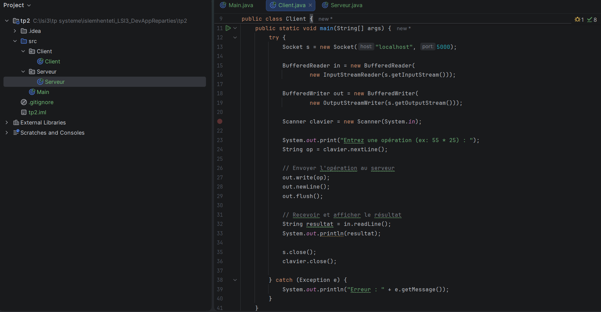

### Code du serveur
Le serveur reçoit la chaîne, la découpe avec `split(" ")`, calcule selon l'opérateur (`+`, `-`, `*`, `/`) et renvoie le résultat.

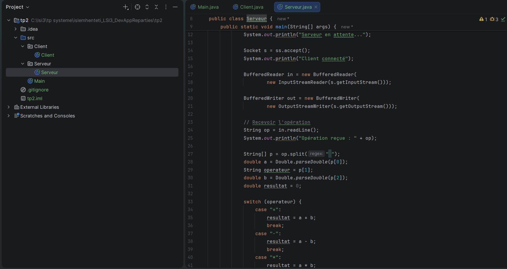

### Exécution

**1. Serveur en attente de connexion**

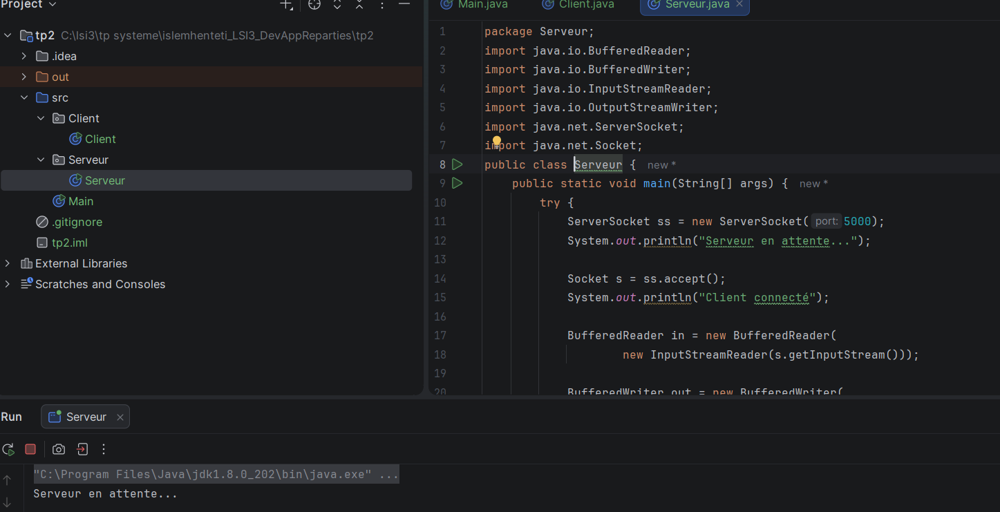

**2. Le client envoie l'opération `5 * 9` et reçoit le résultat `45.0`**


**3. Le serveur affiche l'opération reçue**

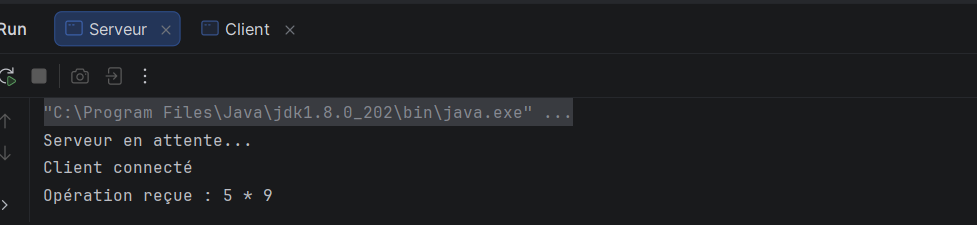

### Tests et gestion des erreurs

**Cas 1 : opération saisie sans espaces (`25*9`)**  
Le serveur découpe la chaîne avec l'espace comme séparateur. Il ne trouve donc pas trois éléments
et provoque une `NumberFormatException` (`For input string: "25*9"`). Le client reçoit
alors `Connection reset`.

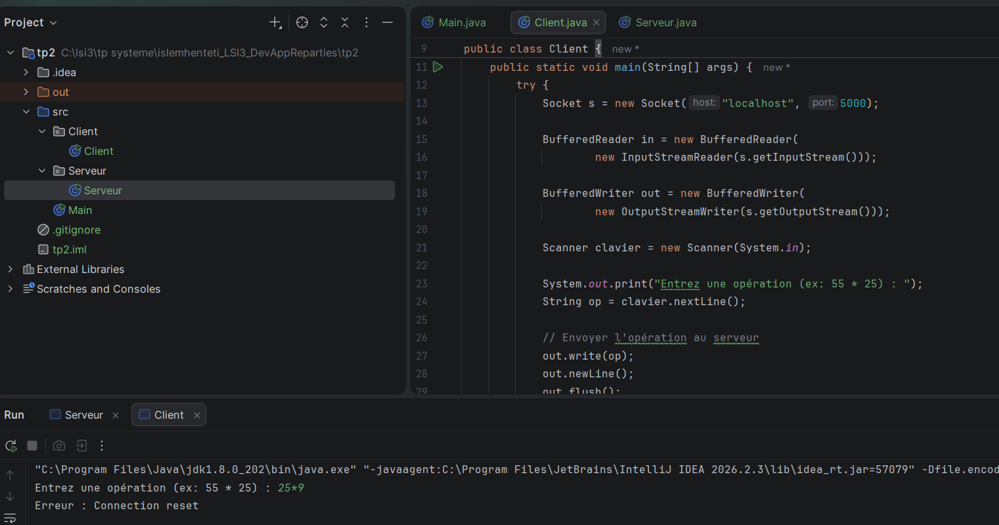

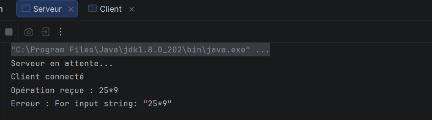

**Cas 2 : chaîne incorrecte (`abc + 3`) sans validation**  
Le serveur plante lors de la conversion et la connexion est réinitialisée.

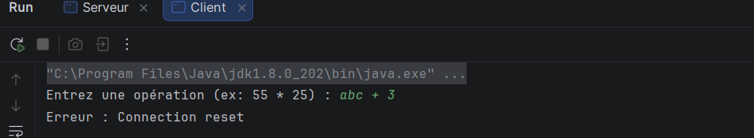

**Cas 3 : validation de la syntaxe côté client (`25 ** 55`)**  
Le client vérifie le format `opérande opérateur opérande` avant l'envoi. Une opération
invalide n'est pas transmise au serveur et le message `Opérateur invalide` s'affiche.

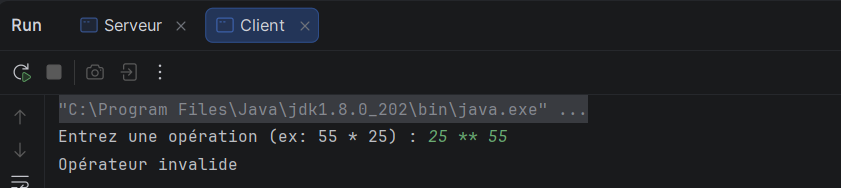

---

# Activité 2-2 : Échange d'objets via les sockets TCP

## Objectif
Faire échanger des **objets Java** entre le client et le serveur grâce à l'interface `Serializable`.

## Flux utilisés
- `ObjectOutputStream` pour envoyer un objet (`writeObject()` + `flush()`)
- `ObjectInputStream` pour recevoir un objet (`readObject()`)

## Étape 1 : Préparation de l'espace de travail
Création du fichier README et ajout des captures au fur et à mesure.

## Étape 2 : Implémentation de l'échange d'objets

### a) Classe `Operation` (Serializable)
La classe contient le premier opérande `a`, l'opérateur `op` et le deuxième opérande `b`,
avec un constructeur et les getters `getA()`, `getOperateur()` et `getB()`.

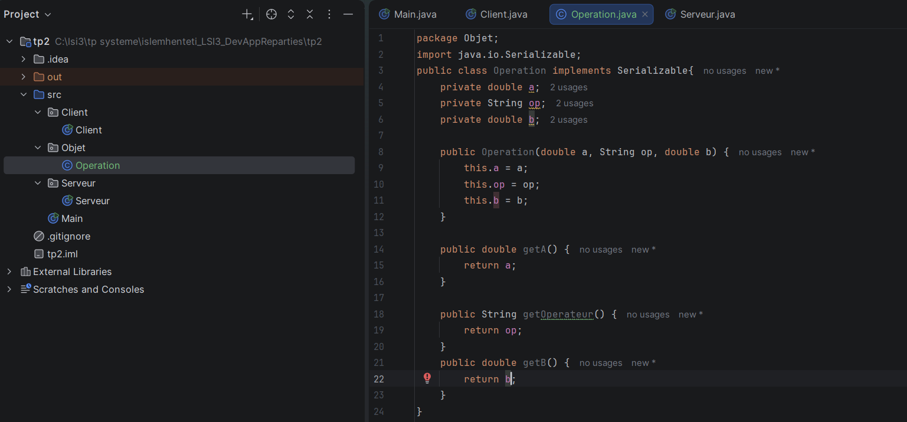

### b) Code du client
Le client saisit le premier nombre, l'opérateur et le deuxième nombre, crée un objet
`Operation`, l'envoie au serveur avec `writeObject()`, puis lit et affiche la réponse.
Une division par zéro est détectée avant la connexion au serveur.

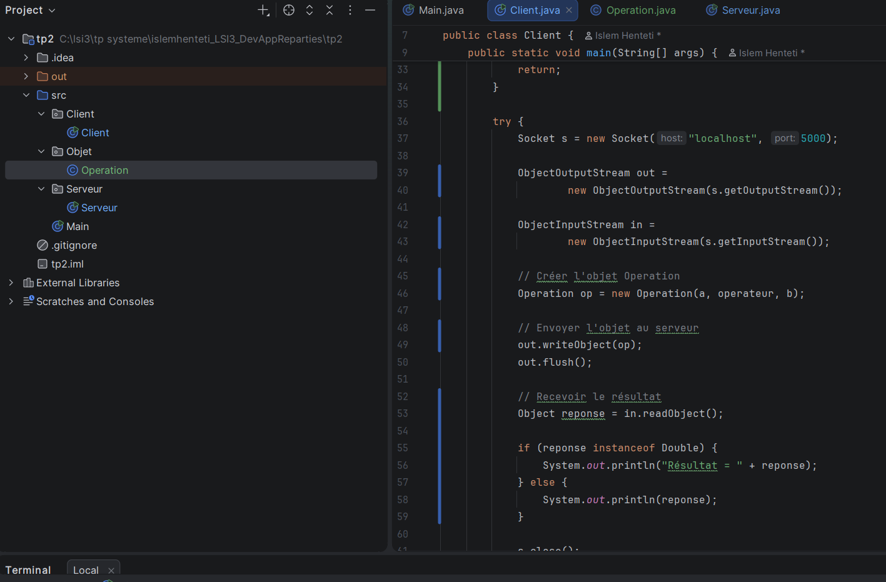

### c, d, e, f) Code du serveur
Le serveur reçoit l'objet (`readObject()`), récupère ses données, effectue le calcul
avec un `switch` sur l'opérateur et renvoie le résultat au client.

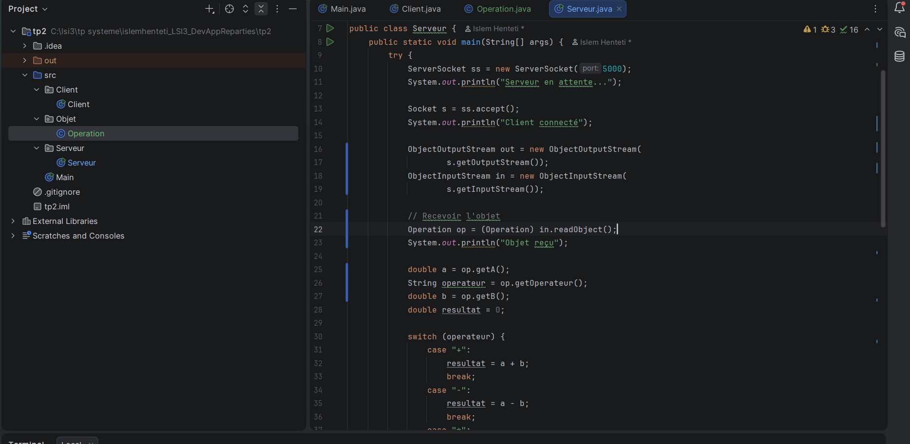

### Exécution

**1. Serveur en attente de connexion**

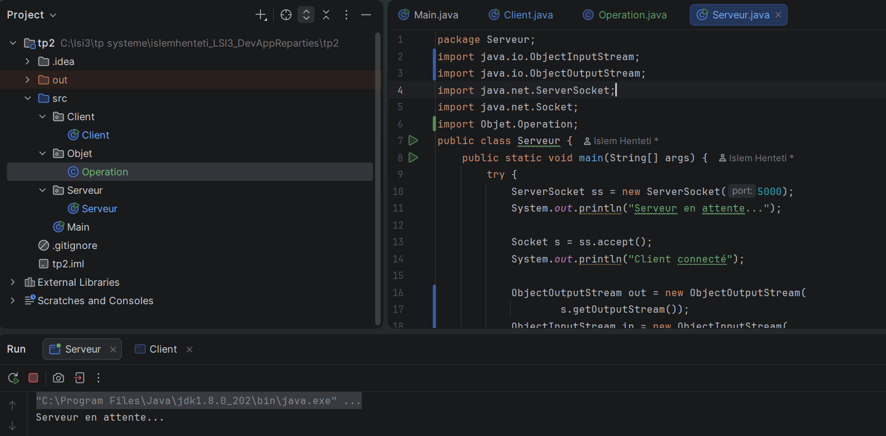

**2. Le serveur reçoit l'objet envoyé par le client**

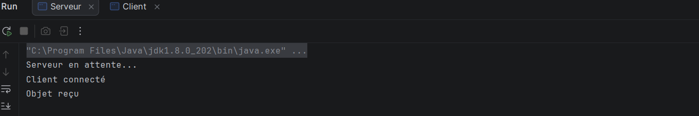

**3. Le client affiche le résultat de `10 + 9`**

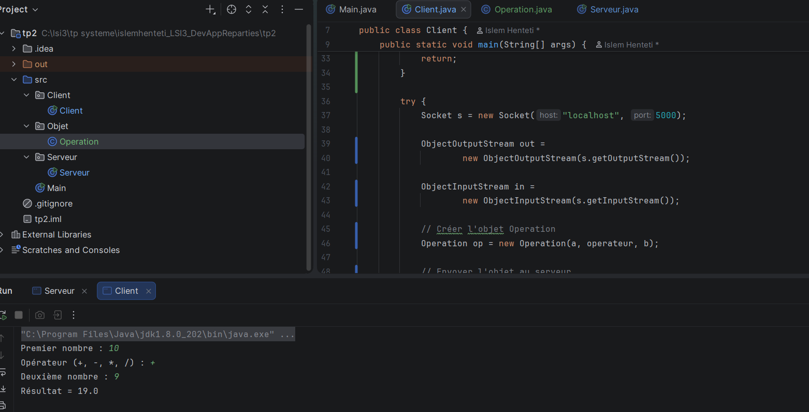

**4. Cas particulier : division par zéro**

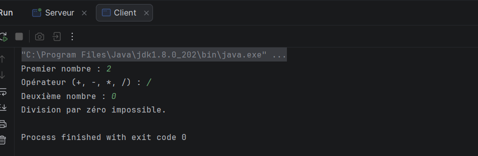

---


## Conclusion
- L'Activité 2-1 a permis de manipuler les flux de caractères pour échanger des opérations complètes.
- L'Activité 2-2 a permis de transmettre des objets sérialisés, ce qui évite le découpage manuel de la chaîne et réduit les erreurs de format.